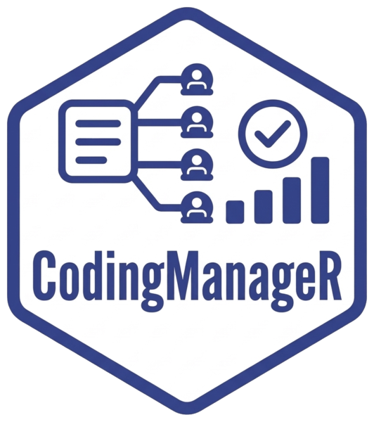

<!-- README.md is generated from README.Rmd. Please edit that file -->

# CodingManageR <a href="https://fberding.github.io/CodingManageR/"></a>

<!-- badges: start -->
[](https://lifecycle.r-lib.org/articles/stages.html#experimental)
[](https://github.com/FBerding/CodingManageR/actions/workflows/R-CMD-check.yaml)
[](https://app.codecov.io/gh/FBerding/CodingManageR)
[](https://CRAN.R-project.org/package=CodingManageR)
[](https://CRAN.R-project.org/package=CodingManageR)
[](https://www.r-project.org/)
[](https://www.gnu.org/licenses/gpl-3.0)
<!-- badges: end -->

**CodingManageR** is an R Shiny web application for qualitative text coding, coder calibration, and inter-rater reliability management. Researchers, instructors, and coding teams use it directly in a web browser to rate textual data—such as classroom observation transcripts, student essays, interview excerpts, or instructional vignettes—on custom ordered numeric scales without writing code during day-to-day coding work.

From early-stage coder training to large-scale empirical data collection, **CodingManageR** supports two flexible deployment modes so it scales effortlessly with the size of your research program:

- **Manage Multiple Projects Locally (SQLite):** Individual researchers and small teams can run the app locally on a laptop or workstation without any server administration. Each study lives in its own self-contained `.sqlite` file with isolated scales, text corpora, bibliographic sources, user accounts, and ratings—making it easy to maintain, back up, and archive **multiple independent projects** side by side.
- **Collaborate Across Locations on Large Projects (Shiny Server + MariaDB/MySQL):** For **larger multi-user studies and multi-site consortia**, CodingManageR connects to a central **MariaDB or MySQL server** (for example behind Open Source Shiny Server). Coders and project administrators can sign in from **different sites, departments, or partner universities** to work simultaneously on one shared, role-protected database while tracking team-wide reliability in real time.

Whether you run a single local study or coordinate an international coding team, **CodingManageR** combines stratified gold-standard training pools, 16 established reliability metrics, transparent source and license tracking, bulk CSV import/export, and a bilingual (English/German) interface with an interactive in-app tour.

## Core Features

- **Balanced Coder Training**: Practice with reference texts that cover every level of a rating scale.
- **16 Reliability Metrics**: Check agreement between a coder and reference answers with 16 standard statistics. These include Cohen's Kappa, Krippendorff's Alpha, Gwet's AC1 and AC2, Iota2, Kendall's W, and Macro F1.
- **Training Reports and Downloads**: View a case-by-case comparison after each training session and download the results as a spreadsheet file.
- **Guided Live Coding**: Read case texts and select scores with a simple slider and live level definitions.
- **Automatic Case Filtering**: Skip already-coded texts and reference training cases automatically during live coding.
- **Role-Based Access Control**: Separate standard coders from administrators and unlock specific scales and sources for each user.
- **Personal Progress Dashboard**: Track live codings, completed training sessions, and reliability trends over time.
- **Searchable Scale Handbook**: Browse all unlocked rating scales and level examples in one place.
- **Reference Examples Window**: Open real coded examples for any scale level during training or live coding.
- **User Management**: Create accounts, generate login passwords, pause inactive users, and manage user permissions.
- **Source and License Directory**: Store citations, coding guidelines, and usage licenses for texts and ratings.
- **Custom Ordinal Scales**: Create rating scales with clear instructions and anchor examples for every level.
- **Team Reliability Overview**: Compare training results across coders and inspect each coder's session history.
- **Rating Corrections**: Search saved ratings and fix individual scoring mistakes safely.
- **CSV Import and Export**: Upload tables in bulk with checked templates and export ready-to-use research datasets.
- **Database Health Checks**: Inspect table counts and check for broken links inside the database.
- **Interactive Getting Started Guide**: Follow a built-in step-by-step tour inside the app with automatic tab switching.
- **Bilingual Interface**: Switch the full interface and the guided tour live between English and German at any time.

## Installation

You can install **CodingManageR** from CRAN or from GitHub.

### From CRAN

Install the stable version from CRAN:

``` r
install.packages("CodingManageR")
```

### From GitHub

Install the newest development version from GitHub with `pak` or `remotes`:

``` r
# Using pak (recommended)
install.packages("pak")
pak::pak("FBerding/CodingManageR")

# Or using remotes
install.packages("remotes")
remotes::install_github("FBerding/CodingManageR")
```

> **Ready to launch the app?** Step-by-step launch instructions, demo credentials, and local SQLite vs. multi-user MariaDB/MySQL server configuration have moved to the dedicated vignettes. Start with the **[Get started ↗](https://fberding.github.io/CodingManageR/articles/introduction.html)** workflow guide or consult **[Installing and Launching CodingManageR ↗](https://fberding.github.io/CodingManageR/articles/CodingManageR.html)** for detailed setup commands.

## Documentation & Guides

Four illustrated, step-by-step vignettes (**English** and **German**) ship with **CodingManageR** and are published online on the package website. Click any **badge** or **guide title** below to open the corresponding vignette directly in your browser:

| Guide | Language | Online Vignette | What It Covers | Open in R |
| :--- | :---: | :---: | :--- | :--- |
| **[Get started: Introduction to CodingManageR ↗](https://fberding.github.io/CodingManageR/articles/introduction.html)** | EN | [](https://fberding.github.io/CodingManageR/articles/introduction.html) | Complete 3-part workflow covering initial project setup (sources, scales, texts), coder training & live coding, and team administration. | `vignette("introduction", package = "CodingManageR")` |
| **[Installing and Launching CodingManageR ↗](https://fberding.github.io/CodingManageR/articles/CodingManageR.html)** | EN | [](https://fberding.github.io/CodingManageR/articles/CodingManageR.html) | Installing the package, running multiple local SQLite projects, exploring demo mode (`empty = FALSE`), and configuring Shiny Server with MariaDB/MySQL. | `vignette("CodingManageR", package = "CodingManageR")` |
| **[Einführung in CodingManageR (Deutsch) ↗](https://fberding.github.io/CodingManageR/articles/introduction-de.html)** | DE | [_%E2%86%92-33418F?style=for-the-badge)](https://fberding.github.io/CodingManageR/articles/introduction-de.html) | Vollständiger 3-teiliger Leitfaden auf Deutsch: Projekteinrichtung (Quellen, Skalen, Falltexte), Kodierschulung & Feldkodierung sowie Team-Administration. | `vignette("introduction-de", package = "CodingManageR")` |
| **[Installation und Start von CodingManageR (Deutsch) ↗](https://fberding.github.io/CodingManageR/articles/CodingManageR-de.html)** | DE | [_%E2%86%92-198754?style=for-the-badge)](https://fberding.github.io/CodingManageR/articles/CodingManageR-de.html) | Paketinstallation, lokale Mehrprojekt-Nutzung mit SQLite, Demo-Modus (`empty = FALSE`) sowie Mehrbenutzer-Setup mit Shiny Server und MariaDB/MySQL. | `vignette("CodingManageR-de", package = "CodingManageR")` |

> **Full Function Reference:** Browse all exported functions and documentation articles on the [CodingManageR Documentation Website ↗](https://fberding.github.io/CodingManageR/).

## Citation & License

**CodingManageR** is licensed under the **GNU General Public License v3.0 (GPL-3)**.

``` r
citation("CodingManageR")
```

> **AI-Assisted Development Notice:** The source code, documentation, vignettes, and built-in demonstration data (example scales, sources, and case texts) of **CodingManageR** were created with the assistance of AI.

Found a bug or have an idea for a new feature? Open an issue on [GitHub Issues](https://github.com/FBerding/CodingManageR/issues).
