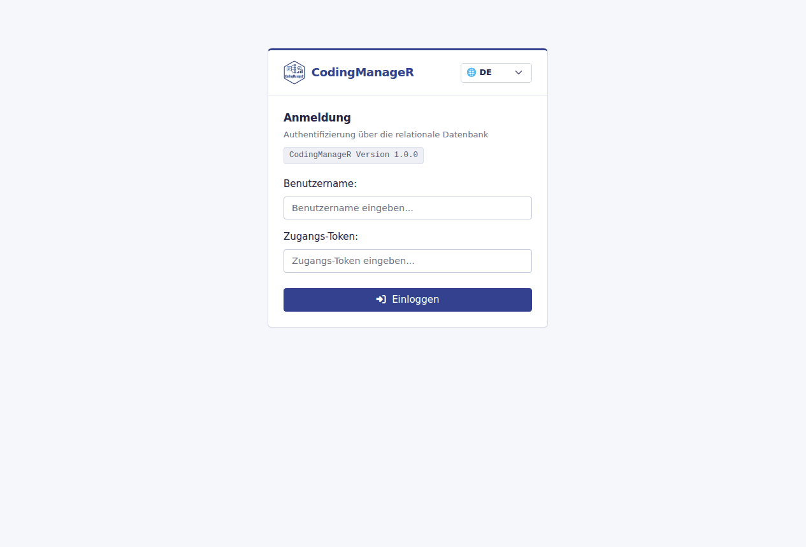
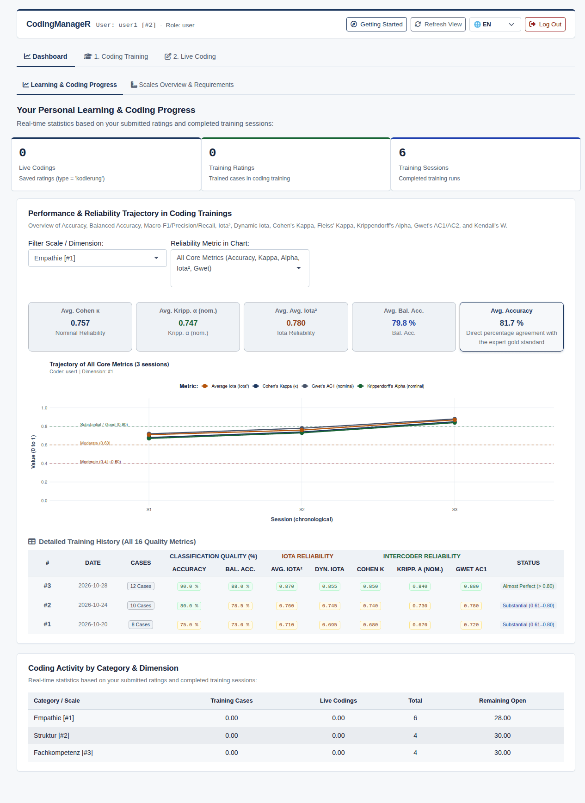

```{r setup, include = FALSE}
knitr::opts_chunk$set(
  collapse = TRUE,
  comment = "#>",
  eval = FALSE
)
```

```{=html}
<style>
.figure, figure {
  margin: 1rem 0 1.35rem 0;
}
.figure img, figure img, p > img {
  border: 1px solid #d8dee6;
  border-radius: 6px;
  box-shadow: 0 2px 8px rgba(15, 23, 42, 0.08);
  margin: 0.25rem 0 0.45rem 0;
}
.figure p.caption, figcaption, .figure-caption {
  color: #475569;
  font-size: 0.9rem;
  line-height: 1.45;
  margin-top: 0.35rem;
}
</style>
```

## 1 Willkommen

**CodingManageR** ist eine Webanwendung für qualitative Textkodierung und Kodiererschulung. Für die tägliche Nutzung müssen Sie keinen Programmiercode schreiben. Nach dem Start arbeiten Sie über übersichtliche Menüs und Schaltflächen direkt im Webbrowser.

Diese Anleitung zeigt Ihnen drei Dinge:

1. Wie Sie **CodingManageR** über **CRAN** oder **GitHub** installieren.
2. Wie Sie die Anwendung in weniger als einer Minute auf Ihrem eigenen Computer starten.
3. *(Optional, für IT-Administratorinnen und IT-Administratoren)* Wie Sie die Anwendung auf einem Linux-Server für ein ganzes Team betreiben.

> **Englische Version verfügbar:** Eine englischsprachige Fassung dieser Installationsanleitung steht über `vignette("CodingManageR", package = "CodingManageR")` bereit.

### 1.1 Welche Einrichtung benötigen Sie?

| Ihre Situation | Empfohlene Einrichtung | Relevanter Abschnitt |
| :--- | :--- | :--- |
| Sie arbeiten allein oder testen die App auf Ihrem Laptop bzw. PC | **Lokaler Modus (SQLite)** — kein Datenbankserver erforderlich | Abschnitte 2 und 3 |
| Mehrere Kodierer melden sich gleichzeitig über einen Weblink an | **Mehrbenutzer-Servermodus (Shiny Server + MariaDB)** | Abschnitte 2 und 4 |

### 1.2 Voraussetzungen

Installieren Sie zuerst **R (Version 4.1.0 oder neuer)** auf Ihrem Computer. Wenn Sie neu mit R arbeiten, empfiehlt sich zusätzlich das kostenlose **RStudio Desktop**. Dort steht ein einfaches Konsolenfenster zur Verfügung, in das Sie die folgenden Befehle kopieren und mit **Enter** ausführen können.

> **Hinweis zur KI-gestützten Erstellung:** Diese Vignette, der Quellcode des Pakets **CodingManageR** sowie alle integrierten Beispieldaten (Kodierskalen, Quellen und Falltexte) wurden mit Hilfe von KI erstellt.

---

## 2 Installation von CodingManageR

Öffnen Sie R oder RStudio und wählen Sie **eine** der beiden folgenden Methoden. Die Installation ist pro Computer nur einmal erforderlich.

### 2.1 Option 1: Installation über CRAN (empfohlen)

CRAN stellt die offizielle stabile Version bereit. Für die meisten Nutzerinnen und Nutzer ist dies der einfachste und zuverlässigste Weg:

```{r}
install.packages("CodingManageR")
```

R lädt automatisch alle benötigten Hilfspakete herunter und installiert sie. Die erste Installation kann einige Minuten dauern.

### 2.2 Option 2: Entwicklungsversion über GitHub installieren

Möchten Sie die neuesten Funktionen bereits vor der nächsten CRAN-Veröffentlichung nutzen, installieren Sie das Paket direkt von GitHub über `pak` (empfohlen) oder `remotes`:

```{r}
# Methode A: mit pak (empfohlen)
install.packages("pak")
pak::pak("FBerding/CodingManageR")

# Methode B: mit remotes
install.packages("remotes")
remotes::install_github("FBerding/CodingManageR")
```

> **Tipp für R-Einsteiger:** Falls R während der Installation fragt, ob ältere Pakete aktualisiert werden sollen, ist Bestätigen mit **Enter** oder die Auswahl `"All"` in der Regel sicher.

---

## 3 Start auf dem eigenen Computer (Lokaler Modus)

Im lokalen Modus verwendet die Anwendung **SQLite**. SQLite ist eine schlanke Datenbank, die als einzelne Datei auf Ihrem Computer gespeichert wird. Darin liegen alle Skalen, Falltexte, Quellen, Benutzerkonten und Kodierungen. Ein separater Datenbankserver wird nicht benötigt.

### 3.1 Schritt 1: Neues, leeres Projekt starten

Fügen Sie diesen Befehl in die R-Konsole ein und drücken Sie **Enter**:

```{r}
CodingManageR::run_app_local()
```

Ihr Webbrowser oder der RStudio-Viewer öffnet sich automatisch und zeigt die Anmeldeansicht von **CodingManageR** (siehe Abbildung 1).

```{r fig-login-de, eval = TRUE, echo = FALSE, out.width = "100%", fig.alt = "Anmeldeansicht von CodingManageR auf Deutsch mit Eingabefeldern fuer Benutzername und Zugangs-Token sowie Sprachauswahl Deutsch und Englisch.", fig.cap = "Abbildung 1: Anmeldeansicht von CodingManageR mit Eingabefeldern für Benutzername und Zugangs-Token sowie der Sprachauswahl (Deutsch/Englisch)."}
if (file.exists("figures-de/01-login.png")) {
  
}
```

Sie können für Ihr Projekt gezielt einen eigenen Dateinamen oder Ordner festlegen. Übergeben Sie dazu den Pfad mit `sqlite_path` oder setzen Sie die Umgebungsvariable `SQLITE_PATH`:

```{r}
CodingManageR::run_app_local(sqlite_path = "mein_kodierprojekt.sqlite")
```

`run_app_local()` benötigt lediglich zwei Parameter (`sqlite_path` und `empty`) und bleibt stets streng im lokalen SQLite-Modus — selbst dann, wenn auf Ihrem Rechner für andere Projekte Umgebungsvariablen wie `MYSQL_HOST` oder `MYSQL_USER` gesetzt sind.

### 3.2 Schritt 2: Optional — App mit integrierten Beispieldaten testen

Nutzen Sie **CodingManageR** zum ersten Mal? Sie können die Anwendung zunächst mit einer Demo-Datenbank ausprobieren, bevor Sie ein eigenes Projekt anlegen. Der Demo-Modus ergänzt Beispielskalen, Beispielfalltexte und Testkonten:

```{r}
CodingManageR::run_app_local(sqlite_path = "coding_demo.sqlite", empty = FALSE)
```

- Leerer Projektstart (`empty = TRUE`, Standard): erzeugt leere Tabellen und ausschließlich das erste Administratorkonto.
- Demo-Start mit Beispieldaten (`empty = FALSE`): ergänzt zusätzlich Beispielskalen, Falltexte, Quellen, Referenzbewertungen sowie ein Test-Kodiererkonto (`user1` / `token2026`).

### 3.3 Schritt 3: Anmelden und Standardpasswort ändern

Beim ersten Start einer neuen Datenbank legt die Anwendung automatisch ein Administratorkonto an:

- **Benutzername:** `admin`
- **Zugangs-Token:** `geheim123`

Melden Sie sich mit diesen Zugangsdaten über **Einloggen** an. Öffnen Sie anschließend **Admin-Bereich -> Benutzerverwaltung** und ersetzen Sie das Zugangs-Token von `admin` umgehend durch ein sicheres eigenes Passwort.

> **Neu bei CodingManageR?** Klicken Sie nach der Anmeldung oben rechts in der Kopfleiste auf **Erste Schritte** (siehe Abbildung 2). Dadurch startet eine interaktive Schritt-für-Schritt-Tour direkt innerhalb der Anwendung.

```{r fig-workspace-dashboard-de, eval = TRUE, echo = FALSE, out.width = "100%", fig.alt = "Angemeldeter Arbeitsbereich von CodingManageR auf Deutsch mit Navigationsreitern, Schaltflaeche Erste Schritte, Kennzahlen-Karten und Reliabilitaetsdiagramm.", fig.cap = "Abbildung 2: Angemeldeter Arbeitsbereich von CodingManageR mit Navigationsreitern, Schaltfläche „Erste Schritte“, persönlichen Kennzahlen und dem Reliabilitätsverlauf."}
if (file.exists("figures-de/02-dashboard.png")) {
  
}
```

### 3.4 Schritt 4: Mehrere lokale Projekte verwalten

Im lokalen Modus entspricht **eine `.sqlite`-Datei genau einem eigenständigen Projekt**. Jede Datei verwaltet ihre eigenen Skalen, Quellen, Falltexte, Benutzerkonten, Kodierungen und Schulungsverläufe vollständig getrennt.

Wenn Sie `CodingManageR::run_app_local()` ohne `sqlite_path` aufrufen, öffnet die App immer dieselbe Standarddatei in Ihrem R-Benutzerordner. Um verschiedene Studien oder Lehrveranstaltungen sauber zu trennen, vergeben Sie pro Projekt einen eigenen `sqlite_path`:

```{r}
# Projekt A: erstellt (oder oeffnet) "studie_a.sqlite" im Arbeitsverzeichnis
CodingManageR::run_app_local(sqlite_path = "studie_a.sqlite")

# Projekt B: erstellt (oder oeffnet) eine zweite, getrennte Datenbank
CodingManageR::run_app_local(sqlite_path = "studie_b.sqlite")
```

Möchten Sie ein Projekt in einem eigenen Unterordner ablegen, erstellen Sie den Ordner zuerst. SQLite legt neue Datenbankdateien nur in bereits vorhandenen Verzeichnissen an:

```{r}
dir.create("projekte/studie_2026", recursive = TRUE, showWarnings = FALSE)
CodingManageR::run_app_local(sqlite_path = "projekte/studie_2026/studie_2026.sqlite")
```

Um später am selben Projekt weiterzuarbeiten, starten Sie die Anwendung einfach erneut mit demselben `sqlite_path`. Alle gespeicherten Skalen, Falltexte und Kodierungen stehen unmittelbar wieder bereit.

#### 3.4.1 Projekte sichern, umbenennen, verschieben und archivieren

Da jedes Projekt in einer einzigen `.sqlite`-Datei liegt, lassen sich Sicherungskopien sehr einfach anlegen. Beachten Sie dabei unbedingt eine wichtige Regel:

1. **Beenden Sie die Anwendung immer zuerst.** Klicken Sie in RStudio auf die rote Stopp-Schaltfläche oder drücken Sie `Esc` bzw. `Strg+C` in der R-Konsole. Während des Betriebs nutzt SQLite **Write-Ahead Logging (WAL)** und hält aktuelle Änderungen kurzzeitig in Hilfsdateien (`-wal` und `-shm`). Beim sauberen Beenden werden diese Änderungen vollständig in die Hauptdatei `.sqlite` zurückgeschrieben.
2. **Sicherungskopie oder Archiv anlegen:** Kopieren Sie die `.sqlite`-Datei auf ein Sicherungslaufwerk oder speichern Sie eine datierte Kopie (z. B. `studie_a_backup_2026-11-22.sqlite`).
3. **Projekt umbenennen oder verschieben:** Benennen Sie die `.sqlite`-Datei im Dateimanager um oder verschieben Sie sie in einen anderen Ordner. Öffnen Sie das Projekt danach mit dem neuen Pfad: `CodingManageR::run_app_local(sqlite_path = "neuer_ordner/umbenanntes_projekt.sqlite")`.
4. **Langfristige Forschungsarchivierung:** Exportieren Sie Ihre Daten zusätzlich als **CSV-Dateien** (offene Tabellenformate für Excel, R oder SPSS). Diese Exporte finden Sie unter **Admin-Bereich -> Daten & Import/Export**.

> **Wichtig:** Lokale SQLite-Dateien sind für die Nutzung durch eine einzelne Person auf einem Computer gedacht. Teilen Sie eine `.sqlite`-Datei nicht gleichzeitig mit mehreren Nutzerinnen und Nutzern über ein Netzlaufwerk. Verwenden Sie für Teams die folgende Server-Einrichtung.

---

## 4 Optional: Mehrbenutzer-Serverbetrieb (für IT-Administration)

> **Hinweis:** Überspringen Sie diesen Abschnitt, wenn Sie CodingManageR ausschließlich lokal auf Ihrem eigenen Computer verwenden. Dieser Abschnitt richtet sich an IT-Verantwortliche oder Projektadministratorinnen und -administratoren, die die App auf einem **Ubuntu**- oder **Debian**-Linux-Server mit **Shiny Server Open Source** und **MariaDB/MySQL** bereitstellen möchten.

### 4.1 Schritt 1: Systempakete und MariaDB installieren

Führen Sie folgende Befehle mit `sudo`-Rechten auf dem Server aus:

```{bash}
sudo apt update
sudo apt install -y r-base r-base-dev libmariadb-dev libcurl4-openssl-dev libssl-dev libxml2-dev mariadb-server gdebi-core wget
```

Starten Sie MariaDB, aktivieren Sie den Autostart und führen Sie die Sicherheitskonfiguration aus:

```{bash}
sudo systemctl start mariadb
sudo systemctl enable mariadb
sudo mariadb-secure-installation
```

### 4.2 Schritt 2: CodingManageR und RMariaDB systemweit installieren

Installieren Sie beide Pakete in der systemweiten R-Bibliothek, damit der Systembenutzer `shiny` darauf zugreifen kann.

Installation der stabilen Version über **CRAN**:

```{bash}
sudo R -e 'install.packages(c("CodingManageR", "RMariaDB"), repos = "https://cloud.r-project.org")'
```

Oder Installation der Entwicklungsversion über **GitHub**:

```{bash}
sudo R -e 'install.packages(c("remotes", "RMariaDB"), repos = "https://cloud.r-project.org"); remotes::install_github("FBerding/CodingManageR")'
```

### 4.3 Schritt 3: Datenbank und Datenbankbenutzer anlegen

Öffnen Sie die MariaDB-Kommandozeile:

```{bash}
sudo mariadb
```

Legen Sie die Datenbank sowie einen eigenen Datenbankbenutzer an. Ersetzen Sie `StarkesPasswortWaehlen` durch ein eigenes sicheres Passwort:

```{sql}
CREATE DATABASE IF NOT EXISTS kodierer_portal
  CHARACTER SET utf8mb4
  COLLATE utf8mb4_unicode_ci;

CREATE USER 'shiny_user'@'localhost' IDENTIFIED BY 'StarkesPasswortWaehlen';
GRANT ALL PRIVILEGES ON kodierer_portal.* TO 'shiny_user'@'localhost';
FLUSH PRIVILEGES;
EXIT;
```

### 4.4 Schritt 4: Shiny Server Open Source installieren

Laden Sie Shiny Server herunter und installieren Sie das Paket (prüfen Sie bei Bedarf die aktuelle Versionsnummer auf der Posit-Website):

```{bash}
wget https://download3.rstudio.org/ubuntu-20.04/x86_64/shiny-server-1.5.22.1017-amd64.deb
sudo gdebi shiny-server-1.5.22.1017-amd64.deb
```

### 4.5 Schritt 5: Einmaligen Einstiegspunkt (`app.R`) anlegen

Erstellen Sie einen Ordner unter `/srv/shiny-server/` und kopieren Sie das minimale Startskript `app.R` einmalig aus **CodingManageR** hinein:

```{bash}
sudo mkdir -p /srv/shiny-server/codingmanager
sudo R -e 'file.copy(system.file("shiny", "app.R", package = "CodingManageR"), "/srv/shiny-server/codingmanager/app.R", overwrite = TRUE)'
sudo chown -R shiny:shiny /srv/shiny-server/codingmanager
```

Intern enthält diese `app.R` lediglich eine Paketprüfung sowie einen parameterlosen Aufruf von `CodingManageR::run_app_server()`. Sie müssen diese Datei nur **ein einziges Mal** anlegen — sie bleibt auch bei künftigen Paket-Updates von **CodingManageR** ohne manuelle Anpassungen funktionsfähig.

> **Sicheres Mehrbenutzer-Verhalten:** `CodingManageR::run_app_server()` erzwingt zwingend MySQL/MariaDB und deaktiviert den SQLite-Fallback vollständig. Fehlen Zugangsdaten oder ist MariaDB nicht erreichbar, bricht der Start mit einer klaren Fehlermeldung in den Shiny-Server-Logs ab, statt still eine lokale SQLite-Datei anzulegen.

### 4.6 Schritt 6: `.Renviron` konfigurieren und Server neu starten

Erstellen Sie eine `.Renviron`-Datei im Ordner `/srv/shiny-server/codingmanager/`, in der Ihre Datenbank-Zugangsdaten sowie optionale Laufzeitparameter gespeichert werden:

```{bash}
sudo nano /srv/shiny-server/codingmanager/.Renviron
```

Fügen Sie diese Zeilen ein und tragen Sie das Passwort aus Abschnitt 4.3 ein:

```ini
MYSQL_HOST=127.0.0.1
MYSQL_PORT=3306
MYSQL_USER=shiny_user
MYSQL_PASSWORD=StarkesPasswortWaehlen
MYSQL_DBNAME=kodierer_portal

# Optionale Laufzeit-Einstellungen (Standardwerte; bei Bedarf auskommentieren):
# CODINGMANAGER_MAX_UPLOAD_GB=3
# CODINGMANAGER_EMPTY=TRUE
```

Beschränken Sie die Dateirechte so, dass ausschließlich der Benutzer `shiny` das Passwort lesen kann, und starten Sie Shiny Server neu:

```{bash}
sudo chown shiny:shiny /srv/shiny-server/codingmanager/.Renviron
sudo chmod 600 /srv/shiny-server/codingmanager/.Renviron
sudo systemctl restart shiny-server
```

Öffnen Sie anschließend `http://<server-ip>:3838/codingmanager/` im Webbrowser. Beim ersten Aufruf erstellt CodingManageR automatisch alle 9 Tabellen in MariaDB sowie das Administratorkonto `admin` mit dem Token `geheim123`. Melden Sie sich an und ändern Sie dieses Passwort sofort.

### 4.7 CodingManageR auf dem Server aktualisieren (ohne Anpassung von `app.R`)

Da `/srv/shiny-server/codingmanager/app.R` ausschließlich `CodingManageR::run_app_server()` aufruft und alle Einstellungen in `.Renviron` liegen, muss `app.R` bei künftigen Paket-Updates weder bearbeitet noch neu kopiert werden. Es genügt, das R-Paket zu aktualisieren und Shiny Server neu zu starten:

```{bash}
# Update ueber CRAN:
sudo R -e 'install.packages("CodingManageR", repos = "https://cloud.r-project.org")'
sudo systemctl restart shiny-server

# Oder Update ueber GitHub:
# sudo R -e 'remotes::install_github("FBerding/CodingManageR")'
# sudo systemctl restart shiny-server
```

---

## 5 Nächste Schritte

Sobald CodingManageR läuft, öffnen Sie die ausführliche Schritt-für-Schritt-Einführung. Dort erfahren Sie, wie Sie Quellen, Skalen, Falltexte, Benutzerkonten, Kodierschulungen, Feldkodierungen und Datenexporte Schritt für Schritt einrichten:

```{r}
vignette("introduction-de", package = "CodingManageR")
```
