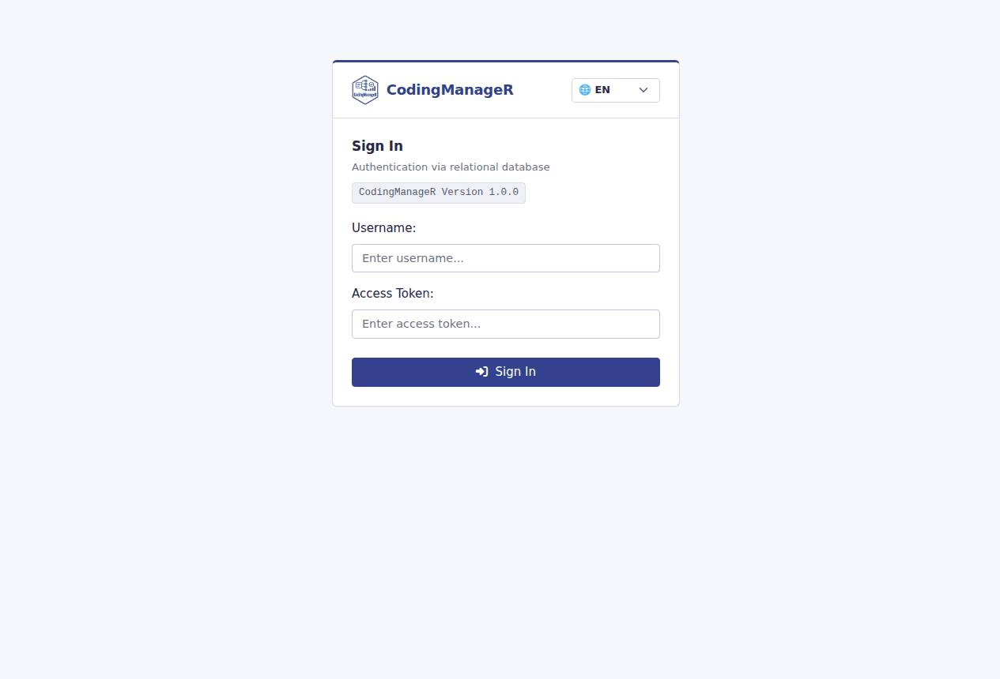
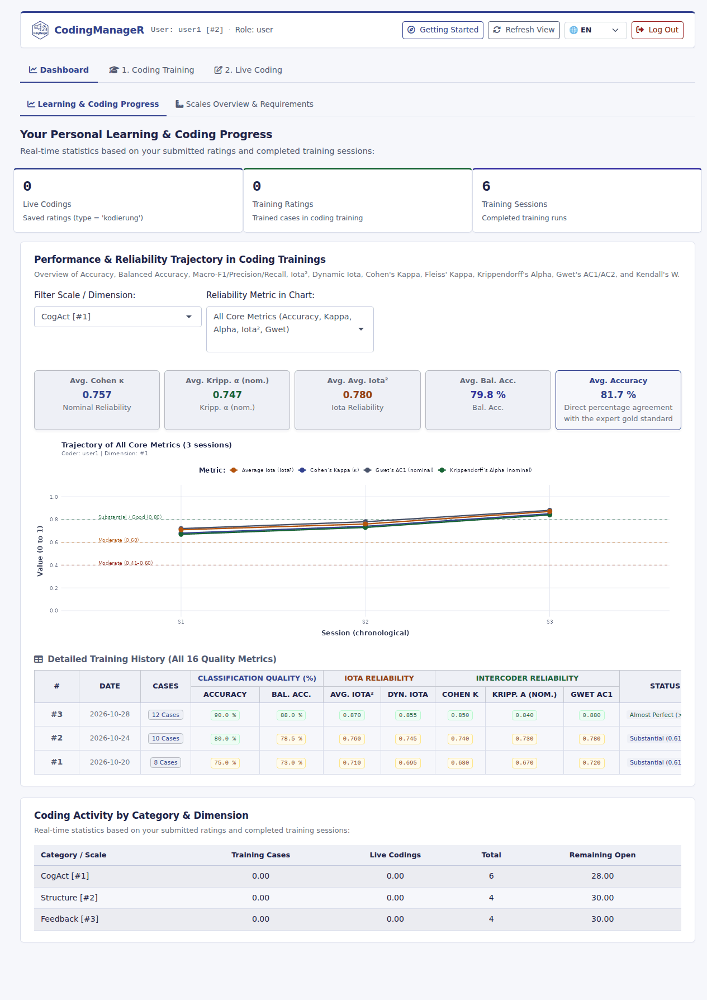

```{r setup, include = FALSE}
knitr::opts_chunk$set(
  collapse = TRUE,
  comment = "#>",
  eval = FALSE
)
```

```{=html}
<style>
.figure, figure {
  margin: 1rem 0 1.35rem 0;
}
.figure img, figure img, p > img {
  border: 1px solid #d8dee6;
  border-radius: 6px;
  box-shadow: 0 2px 8px rgba(15, 23, 42, 0.08);
  margin: 0.25rem 0 0.45rem 0;
}
.figure p.caption, figcaption, .figure-caption {
  color: #475569;
  font-size: 0.9rem;
  line-height: 1.45;
  margin-top: 0.35rem;
}
</style>
```

## 1 Welcome

**CodingManageR** is a web app for qualitative text coding and coder training. You do not need to write code to use it. After you start the app, you work with simple menus and buttons in your web browser.

This guide shows you three things:

1. How to install **CodingManageR** from **CRAN** or **GitHub**.
2. How to start the app on your own computer in under one minute.
3. *(Optional, for IT administrators)* How to run the app on a Linux server for a team.

### 1.1 Which Setup Do You Need?

| Your situation | Recommended setup | Section to follow |
| :--- | :--- | :--- |
| You work alone or test the app on your laptop or PC | **Local Mode (SQLite)** — no database server needed | Sections 2 and 3 |
| Several coders sign in at the same time via a web link | **Multi-User Server Mode (Shiny Server + MariaDB)** | Sections 2 and 4 |

### 1.2 Before You Start

Install **R (version 4.1.0 or newer)** on your computer first. If you are new to R, also install **RStudio Desktop** (free). RStudio gives you a simple console window. You can paste the commands below into that window and press **Enter**.

> **AI-Assisted Development Notice:** This vignette, the **CodingManageR** package source code, and all built-in demonstration examples (coding scales, reference sources, and classroom case texts) were generated with the assistance of AI.

---

## 2 Installing CodingManageR

Open R or RStudio. Choose **one** of the two methods below. You only need to install the package once per computer.

### 2.1 Option 1: Install from CRAN (Recommended)

CRAN offers the official stable version. This is the easiest and safest choice for most users:

```{r}
install.packages("CodingManageR")
```

R downloads and installs all helper packages for you. The first install can take a few minutes.

### 2.2 Option 2: Install the Development Version from GitHub

Want the newest features before the next CRAN release? Install the app from GitHub using `pak` (recommended) or `remotes`:

```{r}
# Method A: using pak (recommended)
install.packages("pak")
pak::pak("FBerding/CodingManageR")

# Method B: using remotes
install.packages("remotes")
remotes::install_github("FBerding/CodingManageR")
```

> **Tip for R beginners:** R may ask if you want to update older packages. Pressing **Enter** or choosing `"All"` is usually safe.

---

## 3 Launching on Your Own Computer (Local Mode)

In Local Mode, the app uses **SQLite**. SQLite is a simple database saved as a single file on your computer. It holds all your scales, texts, sources, users, and ratings. You do not need a separate database server.

### 3.1 Step 1: Start a Clean Project

Paste this command into the R console and press **Enter**:

```{r}
CodingManageR::run_app_local()
```

Your browser or RStudio viewer opens automatically. You will see the **CodingManageR** sign-in screen (see Figure 1).

```{r fig-login, eval = TRUE, echo = FALSE, out.width = "100%", fig.alt = "CodingManageR sign-in screen showing username and access token inputs along with the English and German language selector.", fig.cap = "Figure 1: CodingManageR sign-in screen with username and access token fields and the English/German language selector."}
if (file.exists("figures/01-login.png")) {
  
}
```

You can also choose a specific file name or folder for your project. Pass the path with `sqlite_path`, or set the `SQLITE_PATH` environment variable:

```{r}
CodingManageR::run_app_local(sqlite_path = "my_coding_project.sqlite")
```

`run_app_local()` accepts only two parameters (`sqlite_path` and `empty`) and always stays isolated in local SQLite mode—even if `MYSQL_HOST` or `MYSQL_USER` environment variables are set on your computer for other projects.

### 3.2 Step 2: Optional — Try the App with Built-In Sample Data

Are you using **CodingManageR** for the first time? You can try a demo database before you build your own project. Demo mode adds sample scales, example texts, and test accounts:

```{r}
CodingManageR::run_app_local(sqlite_path = "coding_demo.sqlite", empty = FALSE)
```

- Clean project start (`empty = TRUE`, default): creates empty tables and only the first administrator account.
- Sample demo start (`empty = FALSE`): also adds example scales, texts, sources, reference ratings, and a sample coder (`user1` / `token2026`).

### 3.3 Step 3: Sign In and Change the Default Password

When you start a new database for the first time, the app creates one administrator account:

- **Username:** `admin`
- **Access Token:** `geheim123`

Sign in with this account. Then open **Admin Console -> User Management** and change the `admin` access token right away.

> **New to CodingManageR?** Click **Getting Started** (*Erste Schritte*) in the top-right header after you sign in (see Figure 2). It starts an interactive step-by-step tour right inside the app.

```{r fig-workspace-dashboard, eval = TRUE, echo = FALSE, out.width = "100%", fig.alt = "CodingManageR authenticated workspace displaying the top navigation tabs, header actions including Getting Started, KPI summary cards, and reliability progress chart.", fig.cap = "Figure 2: Authenticated CodingManageR workspace showing the navigation tabs, Getting Started tour button, personal coding KPIs, and reliability progress chart."}
if (file.exists("figures/02-dashboard.png")) {
  
}
```

### 3.4 Step 4: Managing Multiple Local Projects

In Local Mode, **one `.sqlite` file is one separate project**. Each file keeps its own scales, sources, case texts, user accounts, ratings, and training history.

If you run `CodingManageR::run_app_local()` without `sqlite_path`, the app always opens the same default file in your R user folder. To keep different studies or courses separate, use a different `sqlite_path` for each project:

```{r}
# Project A: creates (or opens) "study_a.sqlite" in your working folder
CodingManageR::run_app_local(sqlite_path = "study_a.sqlite")

# Project B: creates (or opens) a second, separate database
CodingManageR::run_app_local(sqlite_path = "study_b.sqlite")
```

Want to store a project in its own subfolder? Create the folder first. SQLite only creates new database files inside folders that already exist:

```{r}
dir.create("projects/study_2026", recursive = TRUE, showWarnings = FALSE)
CodingManageR::run_app_local(sqlite_path = "projects/study_2026/study_2026.sqlite")
```

To open the same project again later, run the command with the same `sqlite_path`. All saved scales, texts, and ratings will be there.

#### 3.4.1 Backing Up, Renaming, Moving, and Archiving Projects

Each project lives in one `.sqlite` file, so backups are easy. Follow one important rule first:

1. **Always stop the app first.** Click the red Stop button in RStudio, or press `Esc` or `Ctrl+C` in R. While the app runs, SQLite uses **Write-Ahead Logging (WAL)**. WAL keeps recent changes in temporary helper files (`-wal` and `-shm`). Stopping the app saves those helper files cleanly back into your main `.sqlite` file.
2. **Back up or archive a copy:** Copy the `.sqlite` file to a backup drive or save a dated copy (for example `study_a_backup_2026-11-22.sqlite`).
3. **Rename or move a project:** Rename or move the `.sqlite` file in your file explorer. Then open it with the new path: `CodingManageR::run_app_local(sqlite_path = "new_folder/renamed_project.sqlite")`.
4. **Long-term research archiving:** Also export your data as **CSV** files (simple table files for Excel, R, or SPSS). You can download them in **Admin Console -> Data & Import/Export**.

> **Important:** Local SQLite files are only for one person on one computer. Do not share one `.sqlite` file with several users at the same time on a network drive. Use the server setup below for teams.

---

## 4 Optional: Multi-User Server Setup (For IT Administrators)

> **Note:** Skip this section if you only use CodingManageR on your own computer. This section is for IT staff or project admins who host the app on an **Ubuntu** or **Debian** Linux server. It uses **Shiny Server Open Source** (the web server) and **MariaDB/MySQL** (the shared database).

### 4.1 Step 1: Install System Packages and MariaDB

Run these commands on the server with `sudo` rights:

```{bash}
sudo apt update
sudo apt install -y r-base r-base-dev libmariadb-dev libcurl4-openssl-dev libssl-dev libxml2-dev mariadb-server gdebi-core wget
```

Start MariaDB, enable it at boot, and run its security setup:

```{bash}
sudo systemctl start mariadb
sudo systemctl enable mariadb
sudo mariadb-secure-installation
```

### 4.2 Step 2: Install CodingManageR and RMariaDB System-Wide

Install both packages into the system library. This lets the `shiny` service user load them.

To install the stable release from **CRAN**:

```{bash}
sudo R -e 'install.packages(c("CodingManageR", "RMariaDB"), repos = "https://cloud.r-project.org")'
```

Or install the development version from **GitHub**:

```{bash}
sudo R -e 'install.packages(c("remotes", "RMariaDB"), repos = "https://cloud.r-project.org"); remotes::install_github("FBerding/CodingManageR")'
```

### 4.3 Step 3: Create the Database and Database User

Open the MariaDB command line:

```{bash}
sudo mariadb
```

Create the database and a database user. Replace `ChooseAStrongPassword` with your own strong password:

```{sql}
CREATE DATABASE IF NOT EXISTS kodierer_portal
  CHARACTER SET utf8mb4
  COLLATE utf8mb4_unicode_ci;

CREATE USER 'shiny_user'@'localhost' IDENTIFIED BY 'ChooseAStrongPassword';
GRANT ALL PRIVILEGES ON kodierer_portal.* TO 'shiny_user'@'localhost';
FLUSH PRIVILEGES;
EXIT;
```

### 4.4 Step 4: Install Shiny Server Open Source

Download and install Shiny Server. You can check the Posit website for a newer version number if needed:

```{bash}
wget https://download3.rstudio.org/ubuntu-20.04/x86_64/shiny-server-1.5.22.1017-amd64.deb
sudo gdebi shiny-server-1.5.22.1017-amd64.deb
```

### 4.5 Step 5: Create the Set-Once Application Entrypoint

Create a folder inside `/srv/shiny-server/` and place the minimal `app.R` launcher inside it once. You can copy the bundled entrypoint directly from **CodingManageR**:

```{bash}
sudo mkdir -p /srv/shiny-server/codingmanager
sudo R -e 'file.copy(system.file("shiny", "app.R", package = "CodingManageR"), "/srv/shiny-server/codingmanager/app.R", overwrite = TRUE)'
sudo chown -R shiny:shiny /srv/shiny-server/codingmanager
```

Internally, this `app.R` contains nothing more than a package check and a zero-argument call to `CodingManageR::run_app_server()`. You only need to create this file **once**—it stays valid across future **CodingManageR** package updates without manual edits.

> **Safe multi-user behavior:** `CodingManageR::run_app_server()` strictly enforces MySQL/MariaDB and disables SQLite fallback completely. If credentials are missing or MariaDB is unreachable, the app stops with a clear error message in the Shiny Server logs instead of silently creating a local SQLite file.

### 4.6 Step 6: Configure `.Renviron` and Restart

Create an `.Renviron` file inside `/srv/shiny-server/codingmanager/` to store your database credentials and any optional runtime settings:

```{bash}
sudo nano /srv/shiny-server/codingmanager/.Renviron
```

Paste these lines and enter the password from Section 4.3:

```ini
MYSQL_HOST=127.0.0.1
MYSQL_PORT=3306
MYSQL_USER=shiny_user
MYSQL_PASSWORD=ChooseAStrongPassword
MYSQL_DBNAME=kodierer_portal

# Optional runtime settings (defaults shown; omit if not needed):
# CODINGMANAGER_MAX_UPLOAD_GB=3
# CODINGMANAGER_EMPTY=TRUE
```

Lock the file permissions so only the `shiny` user can read the password. Then restart Shiny Server:

```{bash}
sudo chown shiny:shiny /srv/shiny-server/codingmanager/.Renviron
sudo chmod 600 /srv/shiny-server/codingmanager/.Renviron
sudo systemctl restart shiny-server
```

Open `http://<server-ip>:3838/codingmanager/` in a web browser. On the first visit, CodingManageR creates all 9 database tables in MariaDB automatically. It also creates the `admin` account with token `geheim123`. Sign in and change that password right away.

### 4.7 Upgrading CodingManageR on the Server (Zero Entrypoint Edits)

Because `/srv/shiny-server/codingmanager/app.R` only calls `CodingManageR::run_app_server()` and all credentials live in `.Renviron`, updating the server to a newer release of **CodingManageR** never requires editing or re-copying `app.R`. Simply install the updated package and restart Shiny Server:

```{bash}
# Update from CRAN:
sudo R -e 'install.packages("CodingManageR", repos = "https://cloud.r-project.org")'
sudo systemctl restart shiny-server

# Or update from GitHub:
# sudo R -e 'remotes::install_github("FBerding/CodingManageR")'
# sudo systemctl restart shiny-server
```

---

## 5 Next Steps

Now that CodingManageR is running, open the step-by-step workflow guide. It shows how to set up scales, texts, sources, coders, training sessions, and exports:

```{r}
vignette("introduction", package = "CodingManageR")
```
