```{r setup, include = FALSE}
knitr::opts_chunk$set(
  collapse = TRUE,
  comment = "#>",
  eval = FALSE
)
```

```{=html}
<style>
.figure, figure {
  margin: 1rem 0 1.35rem 0;
}
.figure img, figure img, p > img {
  border: 1px solid #d8dee6;
  border-radius: 6px;
  box-shadow: 0 2px 8px rgba(15, 23, 42, 0.08);
  margin: 0.25rem 0 0.45rem 0;
}
.figure p.caption, figcaption, .figure-caption {
  color: #475569;
  font-size: 0.9rem;
  line-height: 1.45;
  margin-top: 0.35rem;
}
</style>
```

## 1 Welcome

**CodingManageR** helps researchers, teachers, and students run qualitative text coding projects in a web browser. After you open the app, you do not need any R coding skills. You set up projects, train coders, and collect ratings with simple clicks.

This guide follows the three main steps of a coding project:

| Part | Focus | Main audience |
| :--- | :--- | :--- |
| **Part 1: Initial Setup (Section 3)** | Change the admin password and add **sources**, **coding scales**, and **case texts** | Project lead / Administrator |
| **Part 2: The Coding Process (Section 4)** | Add **new users**, run **coder training**, and record **live codings** | Project lead & Coders |
| **Part 3: Further Admin Tools (Section 5)** | Check team quality, fix ratings, export data, upload CSV files, and check the database | Project lead / Administrator |

Have you not installed CodingManageR yet? Read the installation guide first:

```{r}
vignette("CodingManageR", package = "CodingManageR")
```

> **AI-Assisted Development Notice:** This vignette, the **CodingManageR** package source code, and all built-in demonstration examples (coding scales, reference sources, and classroom case texts) were generated with the assistance of AI.

---

## 2 Before You Begin

### 2.1 Key Terms in Plain English

If you are new to text coding, these six terms will help you understand the app:

| Term in the App | Plain-English Meaning |
| :--- | :--- |
| **Coding Scale** (or *Dimension*) | A rating rule with ordered whole numbers starting at `0`. Example: `0` = not present, `1` = partly present, `2` = clearly present. |
| **Case Text** | One single text that a coder reads and rates. Examples are a classroom observation transcript, a student essay, or a reflection journal entry. |
| **Source** | A bibliographic or project reference for a text, a coding scale/manual, or a rating itself. A **Text Source** documents where a case text originated. A **Coding Source** documents not only where the coding scale, manual, or study protocol came from, but can also specify where the **coding (the rating/evaluation of a text) itself originated**—for example, an external study, expert consensus panel, or published benchmark dataset. |
| **Gold Standard** (Reference Case) | A case text with an agreed reference score. Together with other already-coded cases for a category, these reference cases allow coders to practice and verify agreement during training. |
| **Inter-Rater Reliability** | A statistical measure of agreement among raters (which can involve two or more coders). In CodingManageR training, reliability is calculated not only against explicit `gold_standard` entries, but across **all already-coded reference cases available for a category**. |
| **Access Token** | The personal password that a user enters together with their username to sign in. |

### 2.2 Launching the App and Switching Language

To start a clean local project on your computer, open R or RStudio and run:

```{r}
CodingManageR::run_app(sqlite_path = "my_project.sqlite")
```

If your university or team hosts CodingManageR on a server, open the web link from your administrator in a browser.

> **Quick Tip — Want to Practice First?** You can test the app with sample scales, example texts, and demo accounts before you start your own project. Run:
> `CodingManageR::run_app(sqlite_path = "demo_project.sqlite", empty = FALSE)`

> **Working on Multiple Local Projects?** In Local Mode, the app stores each project in its own **SQLite** file (a single local database file on your computer). Use a different file name for each study, such as `CodingManageR::run_app(sqlite_path = "study_a.sqlite")` and `CodingManageR::run_app(sqlite_path = "study_b.sqlite")`. Always stop the app before you copy, rename, or archive a `.sqlite` file. See `vignette("CodingManageR", package = "CodingManageR")` for folder and backup tips.

You can switch the language between **English** and **German** on the sign-in screen or in the top-right header. Your work stays safe when you switch.

### 2.3 Built-In Interactive Walkthrough (`Getting Started`)

You do not need to keep this guide open while you learn the app. After you sign in, click **Getting Started** (*Erste Schritte*) in the top-right header. It opens an interactive step-by-step tour inside the app:

- **Role-Aware Guided Tracks:** Administrators get a **3-part, 12-step** tour that matches Parts 1, 2, and 3 of this guide. Standard coders get a short **4-step** tour for **Part 2** (training, dashboard, and live coding).
- **Automatic Navigation:** When you click Next or Back, the tour highlights each control with a short tip. It also opens the right tab for you automatically.
- **Keyboard & Live Language Support:** Use the **Left/Right Arrow** keys to move through steps. Press **Esc** to close the tour. If you switch between English and German in the header, every tip translates right away.

---

## 3 Part 1: Initial Setup of the App

Follow these four steps in order for every new project. Create **Sources -> Scales -> Case Texts** in this sequence so every dropdown menu is ready when you need it.

### 3.1 Sign In as Administrator and Change the Default Password

1. Open the sign-in screen (see Figure 1) and enter the default admin login:
   - **Username:** `admin`
   - **Access Token:** `geheim123`
2. Click **Sign In**.
3. Open the **Admin Console** tab in the top bar. Stay on the first subtab, **User Management**.
4. Click the edit button next to `admin`. Replace `geheim123` with a strong personal password and save.

> **Why this matters:** Every new database starts with the same default admin password. Change it first to protect your project.

```{r fig-intro-login, eval = TRUE, echo = FALSE, out.width = "100%", fig.alt = "CodingManageR sign-in screen with username field, masked access token input, Sign In button, and English/German language selector.", fig.cap = "Figure 1: Sign-in screen with username and access token inputs and the English/German language selector in the card header."}
if (file.exists("figures/01-login.png")) {
  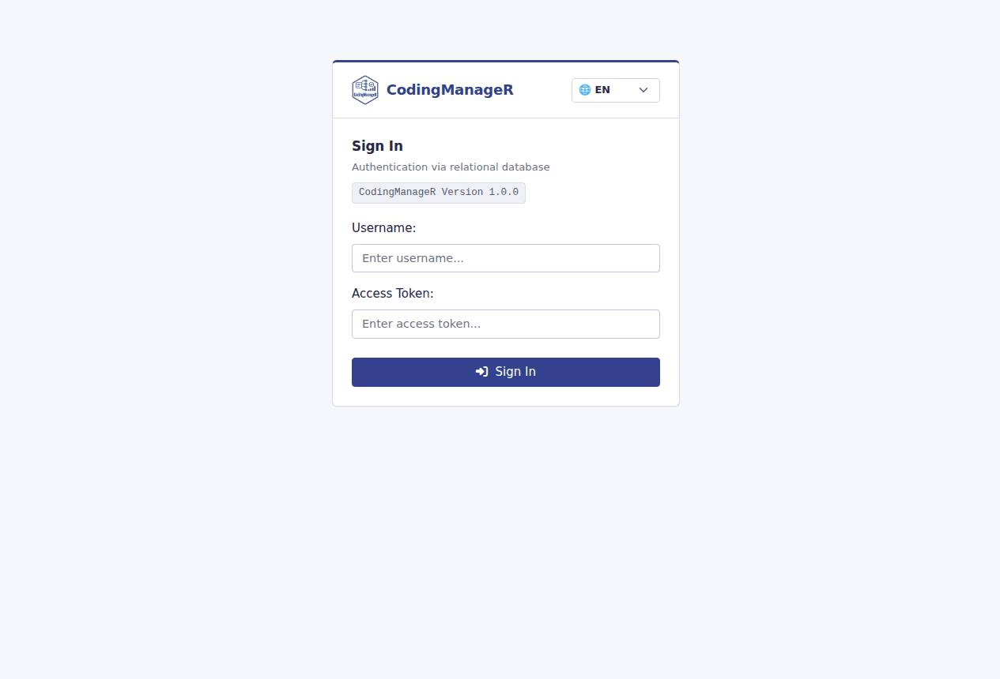
}
```

### 3.2 Step 1: Define Sources (`Sources Directory`)

Before you add texts or start live coding, create at least two sources: one **Text Source** (where your case texts come from) and one **Coding Source** (which documents the coding scale/manual or study protocol **and/or** where the ratings/codings of the texts themselves originated).

1. In **Admin Console**, open the **Sources Directory** subtab (see Figure 2).
2. Click the button to add a new source and fill in three fields:
   - **Short Reference** (for example `StudyA_2026` or `Manual_v1`): a short name for dropdown menus and badges.
   - **Full Reference / Citation**: the full citation or project description.
   - **License / Usage Rights**: pick a standard license (such as `CC-BY 4.0`, `CC0`, or `GPL-3.0`), or choose custom to type your own license text.
3. Click Save. Repeat this for each text collection, coding manual, or external rating provenance in your project. Note the numeric **`ID`** shown in the first column of the table—you will need it as `source_id` when uploading case texts via CSV (see Section 3.4.1).

> **Have many sources in a spreadsheet?** You can upload them all at once with a CSV template (see Section 5.4).

```{r fig-admin-sources, eval = TRUE, echo = FALSE, out.width = "100%", fig.alt = "Admin Console Sources Directory subtab listing scientific sources with short references, full citations, license badges, and edit controls.", fig.cap = "Figure 2: Admin Console — Sources Directory for adding and managing text corpora, citations, and coding protocol licenses."}
if (file.exists("figures/06-admin-sources.png")) {
  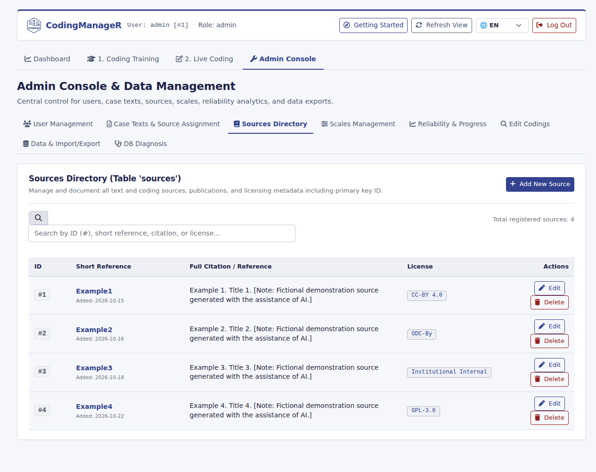
}
```

### 3.3 Step 2: Define Coding Scales (`Scales Management`)

Next, create the rating scales that your coders will use.

1. In **Admin Console**, open the **Scales Management** subtab (see Figure 3).
2. Click the button to create a new scale and fill in:
   - **Short Label** (for example `CogAct` or `Feedback`): a short label for tables and charts.
   - **Scale Name**: the full title shown to coders.
   - **General Coding Description**: a short rule explaining what coders should look for.
   - **Maximum Value (`max_value`)**: the highest score on the scale. Every scale starts at `0`. For example, `max_value = 3` creates four levels: `0`, `1`, `2`, and `3`.
   - **Level Descriptions / Anchor Examples (`0` up to `max_value`)**: write a clear explanation for each number. Coders see this text live when they move the rating slider.
3. Click Save. Repeat this for any other scales.

> **Important Rule:** You can edit text descriptions at any time later. However, **`max_value` is locked after you create the scale**. This protects saved ratings so scores never change their meaning.

```{r fig-admin-scales, eval = TRUE, echo = FALSE, out.width = "100%", fig.alt = "Admin Console Scales Management subtab listing coding scales with short labels, score ranges from 0 to max_value, and descriptions.", fig.cap = "Figure 3: Admin Console — Scales Management showing configured ordinal coding scales, value ranges, and anchor definitions."}
if (file.exists("figures/07-admin-scales.png")) {
  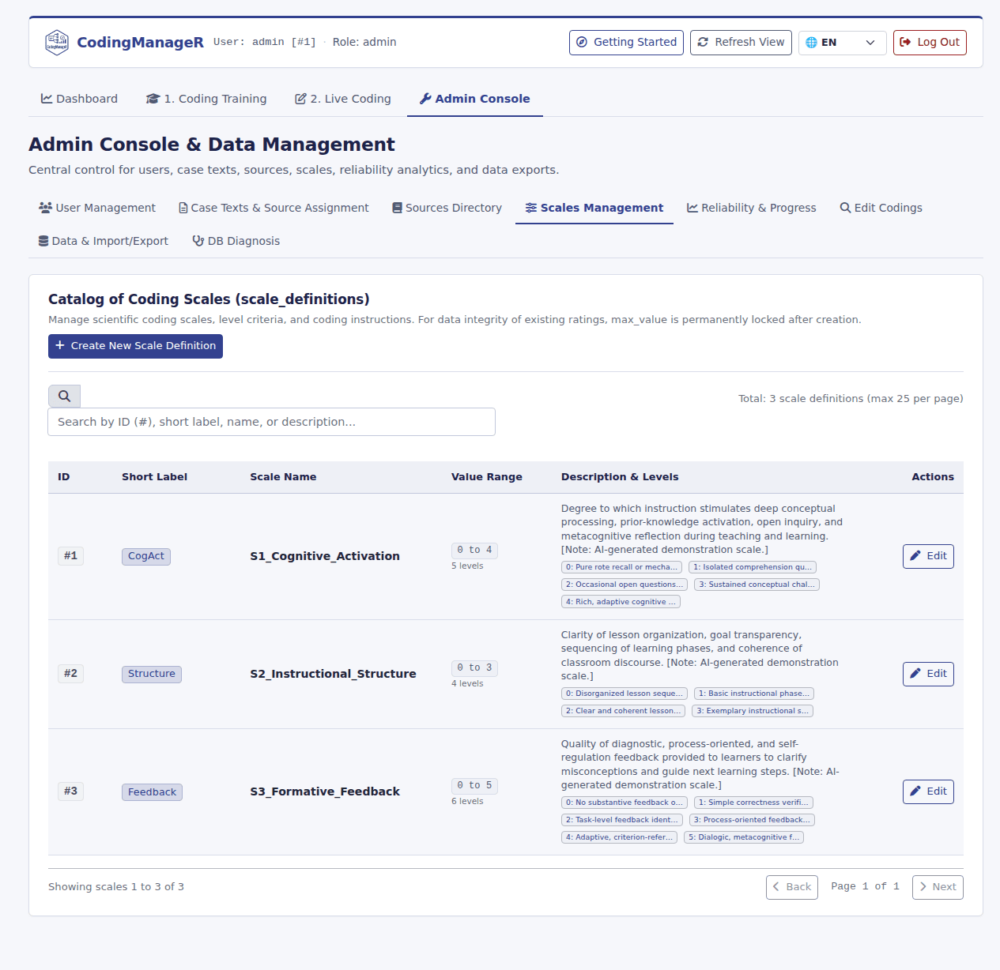
}
```

### 3.4 Step 3: Add Case Texts and Link Sources

Now add your case texts to the database and link each text to its source.

#### 3.4.1 Adding Texts in Bulk via CSV (Recommended)

A **CSV** file is a simple table file that you can edit in Excel or LibreOffice.

1. Open **Admin Console -> Data & Import/Export**.
2. Go to the upload area for **Case Texts (`texts`)** and click **Download CSV Template**. This gives you an empty file with the exact column names (`text_id;text;source_id`).
3. Paste your texts into the `text` column and enter the matching **`source_id`** number in the `source_id` column. You can also add your own `text_id` numbers if you want.
   - **Important (`source_id` must match an existing source):** Every `source_id` value in your CSV file **must exactly match the numeric `ID` of a source that has already been created in the database**. If a `source_id` does not exist in the `sources` table, the app's foreign-key integrity check will reject the upload to prevent broken links.
   - **Where to find the source IDs:** Open **Admin Console -> Sources Directory** (see Figure 2) and look at the very first column titled **`ID`** next to each registered source (for example `1`, `2`, `3`). Alternatively, you can download the `sources` table under **Admin Console -> Data & Import/Export -> Raw Table Backups** and read the exact `source_id` column directly in your spreadsheet editor.
4. Save the file as **UTF-8 CSV** (UTF-8 keeps special characters like German umlauts intact) with a **semicolon (`;`)** as the column separator. Upload the file in the same area.
5. Check the preview table and confirm the import.

#### 3.4.2 Inspecting Texts and Assigning Sources in the Table

1. Open **Admin Console -> Case Texts & Source Assignment** (see Figure 4).
2. Use the search box to find texts by content, ID, or source. The table shows 25 rows per page.
3. Click the source button on any row to assign or change its **Text Source**.

```{r fig-admin-texts, eval = TRUE, echo = FALSE, out.width = "100%", fig.alt = "Admin Console Case Texts and Source Assignment subtab showing a searchable, paginated table of case texts and their assigned text sources.", fig.cap = "Figure 4: Admin Console — Case Texts & Source Assignment with searchable pagination and per-case source linking."}
if (file.exists("figures/08-admin-texts.png")) {
  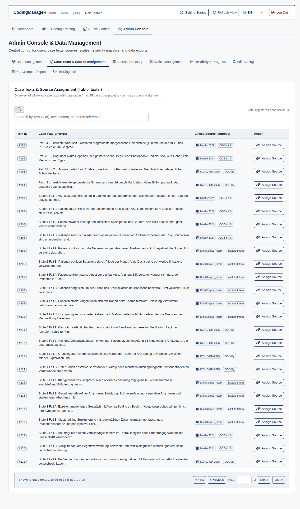
}
```

#### 3.4.3 Preparing Reference Cases for Coder Training

To use **1. Coding Training**, the database needs already-coded reference cases for that category—this includes dedicated **gold standards** (`typ = gold_standard`) as well as completed field codings (`typ = kodierung` / `field`). Try to ensure at least one coded reference text exists for every level from `0` to `max_value`.

You have two easy ways to add reference cases:

- **Option A (Inside the app):** Sign in as admin, open **2. Live Coding**, and rate a starter set of example texts yourself.
- **Option B (CSV upload):** Open **Data & Import/Export** and download the template for **Ratings & Gold Standard (`user_ratings`)**. Enter your reference ratings (making sure `source_id` matches an existing `ID` from **Sources Directory**), then upload the file.

### 3.5 Part 1 Checklist — Ready for Your Team?

- [ ] Default `admin` password changed.
- [ ] At least one **Text Source** and one **Coding Source** created in **Sources Directory** (and their numeric `ID` values noted).
- [ ] All **Coding Scales** created with clear descriptions for levels `0` to `max_value`.
- [ ] **Case Texts** uploaded with valid `source_id` values matching **Sources Directory** and linked to their sources.
- [ ] Already-coded reference cases or gold-standard ratings saved for scales used in training.

---

## 4 Part 2: The Coding Process

Your project setup is now complete. Next, add your coders, let them practice in **Coding Training**, and start **Live Coding**.

### 4.1 Step 1: Add New Users and Grant Permissions (`User Management`)

CodingManageR has two user roles:

- **Coder (`user`)**: Sees **Dashboard**, **1. Coding Training**, and **2. Live Coding**. In Live Coding, coders only see the scales, text sources, and coding sources that an admin unlocks for them.
- **Administrator (`admin`)**: Has access to all scales, all sources, and the full **Admin Console**.

Follow these steps to add a new coder:

1. Open **Admin Console -> User Management** (see Figure 5) and click **Add User**.
2. Enter a unique **Username**, choose role **`user`**, and keep the account **Active**. Type an **Access Token** or click the generator button to create a random password.
3. Save the user. Share the username and access token with the coder safely.
4. Find the new coder in the table. Click the **Scales** and **Sources** permission buttons to unlock:
   - Which **Coding Scales** they can rate in Live Coding.
   - Which **Text Sources** (text pools) they can read.
   - Which **Coding Sources** (protocols) their ratings are saved under.

> **Need to pause a coder later?** Set their status to **Inactive** in **User Management**. They cannot sign in anymore, but all of their saved ratings stay safe.

```{r fig-admin-users, eval = TRUE, echo = FALSE, out.width = "100%", fig.alt = "Admin Console User Management subtab listing user accounts, roles, masked administrator and system tokens, active toggles, and scale and source permission buttons.", fig.cap = "Figure 5: Admin Console — User Management showing user roles, masked administrator and system passwords, active status toggles, and scale/source permissions."}
if (file.exists("figures/05-admin-users.png")) {
  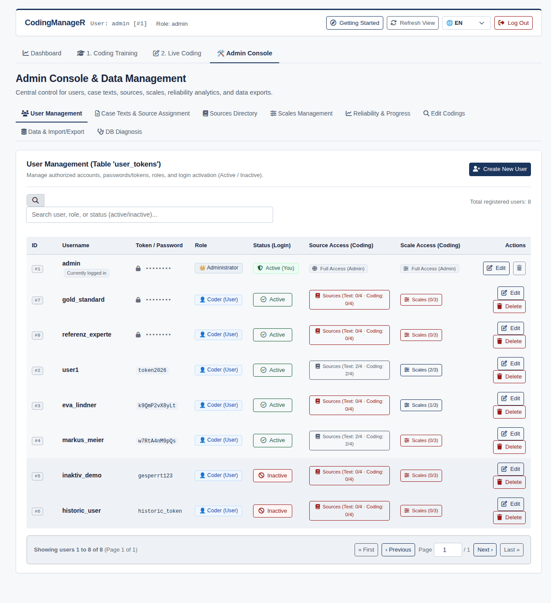
}
```

### 4.2 Step 2: Practice in Coding Training and Review the Dashboard

Coders should practice in **1. Coding Training** before they code real study data. Any signed-in user can practice on any scale that has already-coded reference ratings.

#### 4.2.1 Completing a Training Session

1. Sign in and open the **1. Coding Training** tab.
2. Pick a **Coding Dimension / Scale** from the dropdown menu.
3. Choose how many training cases you want to rate. The app draws a balanced set of already-coded reference cases for that category covering every level (`0` to `max_value`).
4. Optional: Click **Show Criteria & Examples** to read example texts before you start.
5. Click **Start Training**.
6. Rate each case (see Figure 6):
   - Read the case text on the left side.
   - Move the rating slider on the right side to choose your score. The definition box updates live to explain the selected number.
   - Click **Save & Next Case**. On the last text, click **Finish Training & View Results**. To stop early without saving a finished run, click **Abort Training**.
7. At the end, the app compares your scores with the stored reference codings across all selected cases. You see your inter-rater reliability scores and a case-by-case table. You can click **Download Training Results (.csv)** to save a copy, or click **Start New Training** to try again.

```{r fig-coding-training, eval = TRUE, echo = FALSE, out.width = "100%", fig.alt = "Coding Training workspace displaying a case text on the left and the ordinal rating slider with a live level definition box on the right.", fig.cap = "Figure 6: Coding Training workspace displaying the current reference case text alongside the rating slider and live level anchor definition."}
if (file.exists("figures/03-coding-training.png")) {
  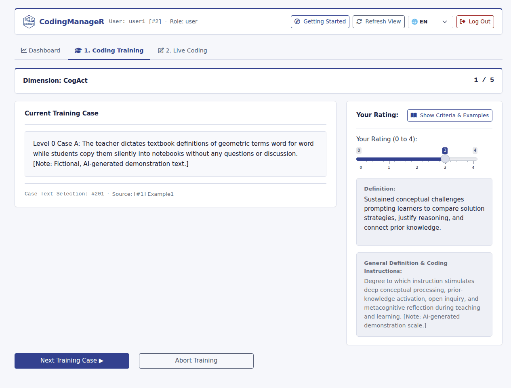
}
```

#### 4.2.2 Checking Personal Progress on the `Dashboard`

Open the **Dashboard** tab at any time to check your progress (see Figure 7):

- **Learning & Coding Progress** subtab:
  - Top cards show your total **Live Codings**, **Training Ratings**, and **Training Sessions**.
  - The chart shows how your agreement improves over time. You can view four main metrics together or pick any of the 16 single metrics.
  - Tables below list every finished training run and show how many open cases remain per scale.
- **Scales Overview & Requirements** subtab:
  - Shows a searchable codebook of all scales unlocked for you, with every score range and anchor example.

> **Tip:** Click **Refresh View** in the top bar if an admin adds new scales, texts, or permissions while you are signed in.

```{r fig-dashboard, eval = TRUE, echo = FALSE, out.width = "100%", fig.alt = "Personal Dashboard displaying KPI cards for live codings, training ratings, and sessions alongside the longitudinal reliability trend chart.", fig.cap = "Figure 7: Personal Dashboard showing coding KPI cards, longitudinal reliability trajectories across training sessions, and per-scale progress tables."}
if (file.exists("figures/02-dashboard.png")) {
  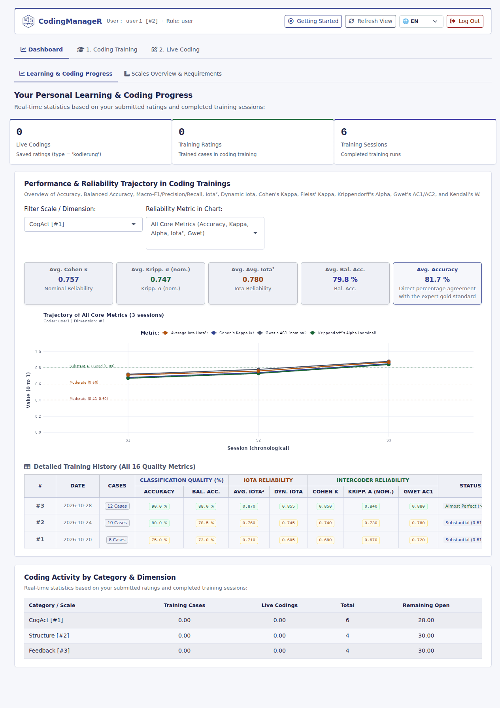
}
```

### 4.3 Step 3: Record Real Ratings in Live Coding (`2. Live Coding`)

When a coder finishes training and has permissions unlocked, they can start real data coding.

#### 4.3.1 Configuring the Workspace

1. Open the **2. Live Coding** tab.
2. Choose three settings:
   - **Coding Dimension / Scale:** Pick one of your unlocked scales.
   - **Case Selection Mode (Text Pool):** Draw random open cases from all your unlocked text sources, or pick one specific text source.
   - **Coding Source / Protocol:** Pick the coding source under which your ratings will be saved.
3. Check the live counter to see how many open cases remain. Then click **Start Coding / Load Case**.

#### 4.3.2 Rating Cases

1. Read the case text on the left (see Figure 8). Check the scale and source details in the banner at the top.
2. Choose your score with the slider on the right. Read the live level definition box, or click **Show Criteria & Examples** when a case is hard to judge.
3. Click **Save & Next Case**. The app saves your rating and loads the next open text right away.
4. Need to change scales or take a break? Click **Back to Configuration** at any time.

The app skips already-coded texts and gold-standard training cases automatically. When no open cases remain in a pool, the app tells you so you can pick another scale or text source.

```{r fig-live-coding, eval = TRUE, echo = FALSE, out.width = "100%", fig.alt = "Live Coding workspace showing the active scale and source banner, case text panel on the left, rating slider with live stage guidance on the right, and Save and Next Case button.", fig.cap = "Figure 8: Live Coding workspace displaying the active scale and source banner, case text panel, rating slider with live stage guidance, and Save & Next Case controls."}
if (file.exists("figures/04-live-coding.png")) {
  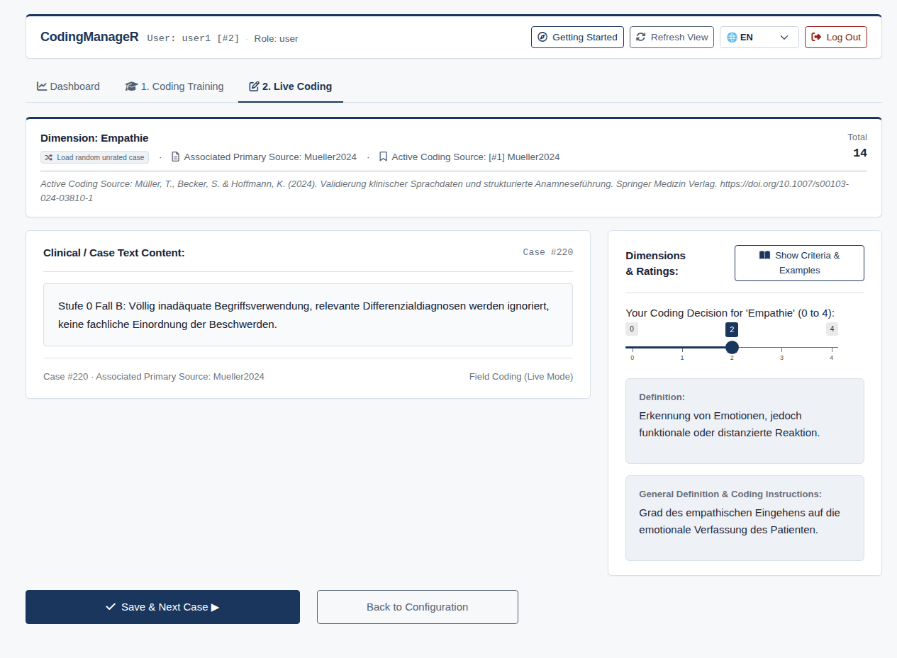
}
```

### 4.4 Part 2 Checklist — Smooth Daily Coding

- [ ] Coder account created with an access token in **User Management**.
- [ ] Needed **Scales**, **Text Sources**, and **Coding Sources** unlocked for the coder.
- [ ] Coder finished at least one **Coding Training** session and checked the **Dashboard**.
- [ ] Coder selects scale, text pool, and coding source in **2. Live Coding** and saves ratings with **Save & Next Case**.

---

## 5 Part 3: Further Options for Administrators

The **Admin Console** also includes five tools for quality checks, data fixes, exports, bulk uploads, and database maintenance.

### 5.1 Monitor Team Quality (`Reliability & Progress`)

Open the **Reliability & Progress** subtab to check activity and agreement across your whole team (see Figure 9):

- View project totals for live codings, finished training sessions, and team averages.
- Filter by **coder**, **scale**, and **reliability metric**. Compare coders in a bar chart and a summary table.
- Click a coder's detail button in the table to open a pop-up window. It shows all of their training sessions and live codings. This helps you spot scales where the team needs clearer examples or more discussion.

```{r fig-admin-reliability, eval = TRUE, echo = FALSE, out.width = "100%", fig.alt = "Admin Console Reliability and Progress subtab displaying team KPI summary cards, filter controls, a coder comparison bar chart, and a summary table.", fig.cap = "Figure 9: Admin Console — Reliability & Progress comparing team training performance and inter-rater reliability metrics across coders."}
if (file.exists("figures/09-admin-reliability.png")) {
  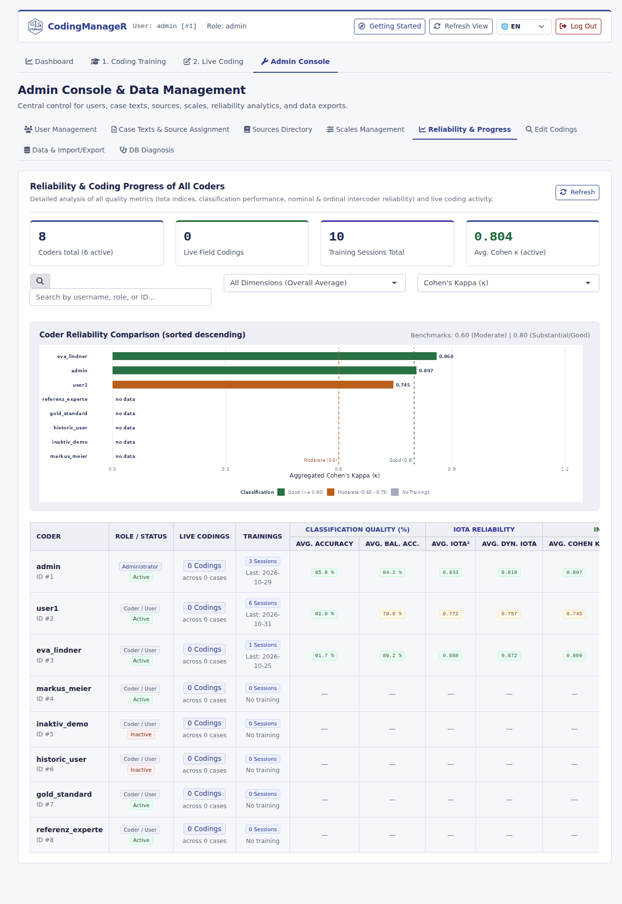
}
```

### 5.2 Find and Correct Stored Ratings (`Edit Codings`)

Mistakes happen. Sometimes a coder clicks the wrong number before saving.

1. Open the **Edit Codings** subtab (see Figure 10).
2. Filter saved ratings by **rating type** (`kodierung`, `gold_standard`, or `schulung`), **scale**, **coder**, **case ID**, or a keyword from the text.
3. Click the edit button on the row you want to fix and enter the new score. The app makes sure the new score stays inside the scale's `0..max_value` range.

```{r fig-admin-edit-codings, eval = TRUE, echo = FALSE, out.width = "100%", fig.alt = "Admin Console Edit Codings subtab with rating type, scale, and keyword filters above a searchable table of stored ratings with edit buttons.", fig.cap = "Figure 10: Admin Console — Edit Codings for filtering stored ratings by type, scale, coder, or keyword and correcting individual score values."}
if (file.exists("figures/10-admin-edit-codings.png")) {
  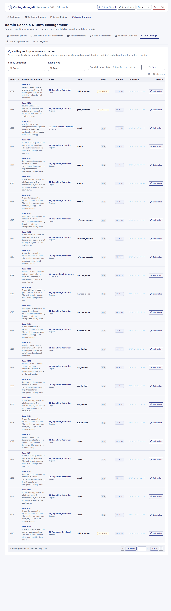
}
```

### 5.3 Export Research Datasets and Backups (`Data & Import/Export`)

Use this subtab when you want to analyze your data in R, SPSS, Excel, or Python, or make a backup (see Figure 11):

- **Consolidated Master Dataset Export:** Combines ratings, full case texts, scale definitions, and full source citations in one ready-to-use CSV file. You can filter by **Scales**, **Sources**, or **Users** before you download.
- **Raw Table Backups:** Download single CSV files for each main table (`scale_definitions`, `texts`, `sources`, `user_ratings`, and `coding_training`) for clean archiving.
- **Full Local Project Snapshot (SQLite Mode):** In Local Mode, you can also back up the whole project in one step. Stop the app cleanly first (so SQLite closes its Write-Ahead Log files), then copy your `.sqlite` file.

### 5.4 Bulk CSV Uploads with Built-In Validation (`Data & Import/Export`)

You can upload or update five tables at once: **Scales**, **Case Texts**, **Sources Directory**, **Ratings & Gold Standard**, and **Training Sessions**.

Follow these steps so your upload works on the first try:

1. Click **Download CSV Template** next to the upload field. This guarantees that all column names match.
2. When uploading **Case Texts (`texts`)** or **Ratings (`user_ratings`)**, verify that every `source_id` matches an existing numeric **`ID`** listed in the first column of **Admin Console -> Sources Directory** (see Section 3.4.1).
3. Save your table as a **UTF-8 CSV** file (keeps special characters safe) with a **semicolon (`;`)** between columns, not a comma.
4. Upload your file. The app cleans small formatting issues and checks every column and foreign key before changing the database.
5. In the confirmation window, choose **append** (add new rows) or **replace** (replace the whole table). If an append upload contains IDs that already exist, the app warns you. You can choose to skip those rows or update them with the new CSV values. Every import runs inside a protected **database transaction**: if any error happens, the app cancels the upload and leaves your old data untouched.

```{r fig-admin-data, eval = TRUE, echo = FALSE, out.width = "100%", fig.alt = "Admin Console Data and Import/Export subtab showing consolidated master dataset export filters, raw table backups, and CSV upload controls.", fig.cap = "Figure 11: Admin Console — Data & Import/Export for filtered consolidated master dataset exports, raw table backups, and schema-validated bulk CSV uploads."}
if (file.exists("figures/11-admin-data-import-export.png")) {
  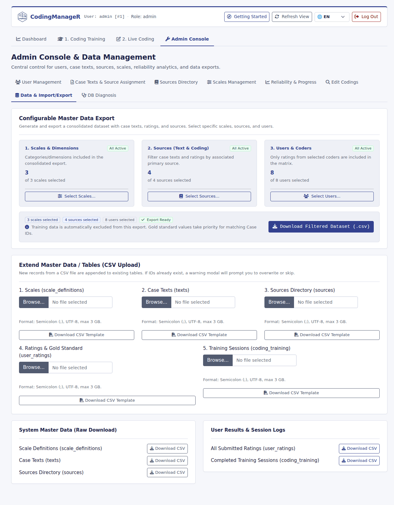
}
```

### 5.5 Check Database Health and Integrity (`DB Diagnosis`)

Open **DB Diagnosis** after big CSV uploads or from time to time during a long study (see Figure 12):

- **Table Overview:** Shows live row counts and status for all 9 database tables (`user_tokens`, `sources`, `texts`, `scale_definitions`, `user_ratings`, `coding_training`, and the three permission tables).
- **Integrity Audit:** Checks for broken links, such as a rating pointing to a missing text or scale, or a text without a valid source. It also checks that foreign-key protection (rules that keep linked tables consistent) is active.

```{r fig-admin-diagnosis, eval = TRUE, echo = FALSE, out.width = "100%", fig.alt = "Admin Console DB Diagnosis subtab displaying live row counts for all nine database tables and relational integrity audit status cards.", fig.cap = "Figure 12: Admin Console — DB Diagnosis summarizing live row counts across all nine database tables and relational integrity checks."}
if (file.exists("figures/12-admin-db-diagnosis.png")) {
  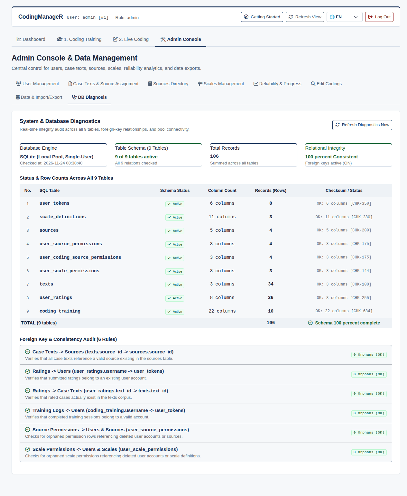
}
```

### 5.6 Administrator Quick-Reference Table

| What do you want to do? | Open this Admin Console subtab |
| :--- | :--- |
| Add a coder, reset a password, or unlock scales and sources | **User Management** |
| Link case texts to their sources | **Case Texts & Source Assignment** |
| Add or edit citations, licenses, and coding protocols | **Sources Directory** |
| Create a new scale or edit anchor examples | **Scales Management** |
| Compare coder agreement across training runs | **Reliability & Progress** |
| Find and fix a single rating value | **Edit Codings** |
| Export analysis-ready CSV data or upload CSV tables | **Data & Import/Export** |
| Check table row counts and database health | **DB Diagnosis** |
